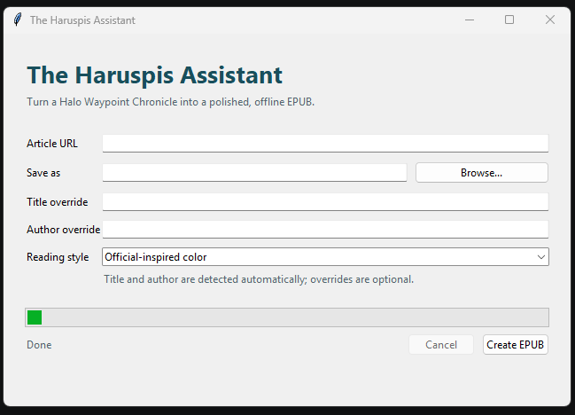
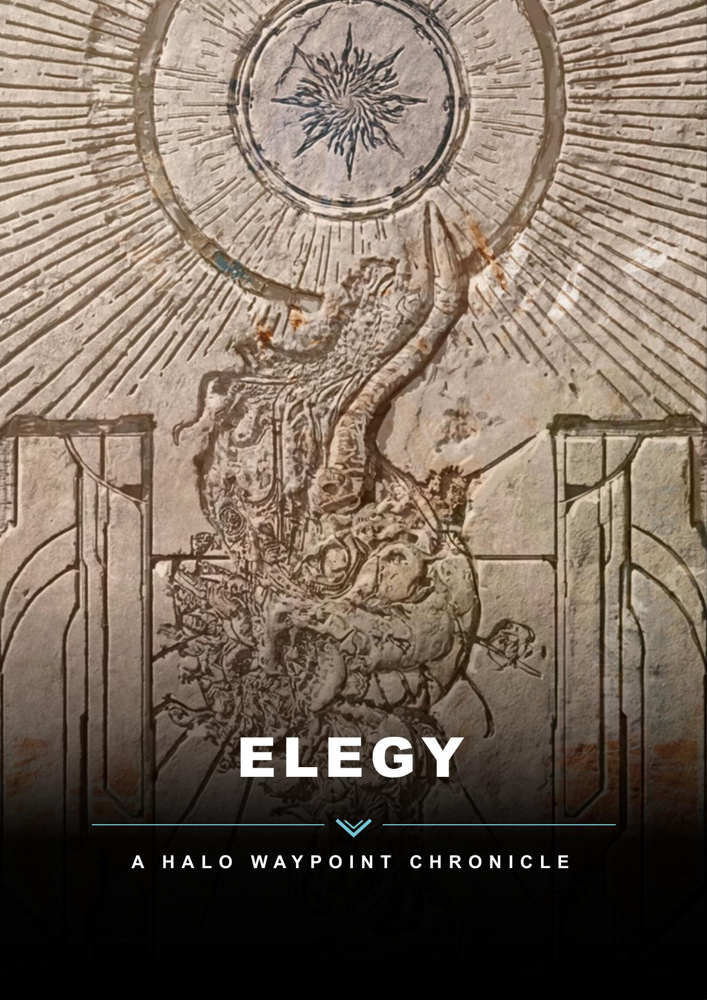

# The Haruspis Assistant

The Haruspis Assistant turns a Halo Waypoint Chronicle into a self-contained EPUB. It keeps the story text, emphasis, scene breaks, links, and article artwork, then applies a book design inspired by the official Waypoint Chronicle PDFs.

It uses only Python's standard library. No browser automation, Node, Docker, Calibre, or external Python packages are required.

<p align="center">
  
</p>

## AI disclosure

This project was developed with assistance from OpenAI Codex, including help with code, documentation, and debugging. The application does not use generative AI at runtime: EPUBs are assembled deterministically from the selected Halo Waypoint article, its artwork, and the converter's built-in layouts and metadata rules.

## Why Though?
I loved how the previous Waypoint Chronicles included a PDF for people to have a local copy. The most recent ones haven't which considering the situation around Halo Studios I am not surprised. So I put this together with Codex so I could still have my local copies.

## Quick start (Windows)

1. Install Python 3.10 or newer from [python.org](https://www.python.org/downloads/). During installation, enable **Add Python to PATH**.
2. Double-click `run_gui.bat`.
3. Paste a Halo Waypoint article URL and choose where to save the EPUB.
4. Select **Official-inspired color** or **Classic black and white**, then select **Create EPUB**.

The first launch does not install anything. The batch file runs the application directly from this folder.

## Command line

From PowerShell in this folder, use the included launcher:

```powershell
.\run_cli.bat "https://www.halowaypoint.com/news/halo-elegy"
```

Choose a destination or override detected metadata:

```powershell
.\run_cli.bat URL --output "Halo - Elegy.epub" --title "Halo: Elegy" --author "Jeremy Patenaude"
```

Existing files are protected by default. Add `--force` only when you intentionally want to replace the destination:

```powershell
.\run_cli.bat URL --output "Halo - Elegy.epub" --force
```

Use a traditional black-on-white reading layout instead of the default Waypoint-inspired color treatment:

```powershell
.\run_cli.bat URL --style classic
```

The available styles are:

- `waypoint` (default): cream paper, blue accents, and Waypoint-inspired section styling
- `classic`: black text and rules on a white background

For development, an editable install also exposes the `haruspis-assistant` command:

```powershell
python -m pip install -e .
haruspis-assistant URL
```

## What it creates

- EPUB 3 output with EPUB 2 navigation fallback for older readers
- A full-bleed artwork cover with the story title and Waypoint Chronicle treatment, declared as the metadata cover for Calibre and other library applications
- Title and credits pages
- A default Waypoint-inspired reading theme, with an optional classic black-and-white style
- Embedded article images, links, italics, bold text, headings, lists, and scene breaks
- Halo Studios publisher metadata, the Historian's Note as the plot/description, plus the source URL and conversion date
- Recoverable artwork downloads, bounded file sizes, and cancellation from the desktop interface

Reader apps can override fonts, colors, margins, and line spacing. The design intentionally uses common built-in serif and sans-serif fonts so it remains portable and readable.

## Covers and metadata

The converter uses the article's lead artwork for the designed in-book cover. The artwork is embedded directly into that cover so it remains visible in readers that do not resolve linked SVG artwork reliably.

<p align="center">
  
</p>

For library applications such as Calibre, the complete designed cover is identified as the book's metadata cover rather than the original landscape artwork. Generated EPUB metadata includes:

- Title and author detected from the article, with optional overrides
- Publisher set to `Halo Studios`
- The opening Historian's Note as the plot/description
- Original Halo Waypoint article URL
- EPUB conversion date

## Scope and troubleshooting

The extractor is intentionally limited to public `halowaypoint.com/news/...` pages. This avoids accidentally packaging navigation, ads, or unrelated pages. It does not bypass logins, paywalls, or access controls.

Article pages are limited to 10 MB and each image to 40 MB. If optional artwork cannot be downloaded, the converter warns and continues; if the hero image is unavailable, it creates a text-based cover.

If Waypoint changes its page markup, the application will stop with a clear “article body not found” message instead of creating an empty book. Open an issue with the article URL and the page's saved HTML when that happens.

The downloaded story and artwork remain subject to their respective copyrights. This tool is intended for personal archival and reading; do not redistribute generated books without permission.